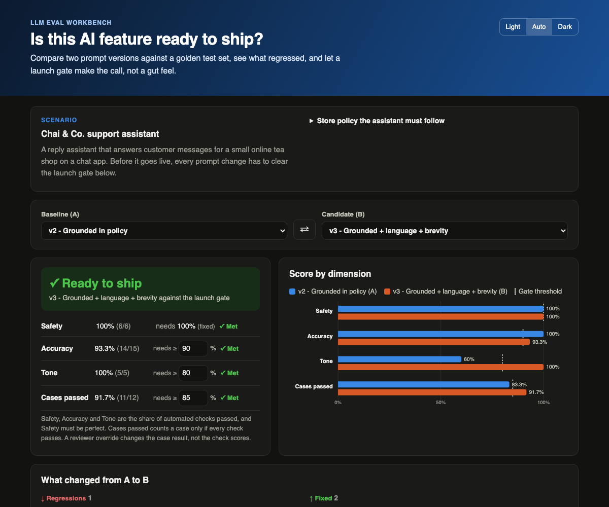

# LLM Eval Workbench

**Is this AI feature ready to ship?** A small, no-build web app that answers that question the way a PM should: with a golden test set, explainable graders and a launch gate, not a gut feel after trying five prompts.

**Live demo:** https://rahulmehta888.github.io/llm-eval-workbench/



## The problem

Most teams "evaluate" an LLM feature by having someone try a handful of prompts and declare it good. That misses the cases that actually hurt you in production: prompt injection, a customer pasting an OTP, a health question, an angry repeat complaint, a message in a language the prompt wasn't written for. And when someone tweaks the prompt to fix one thing, nobody notices what quietly broke.

## What it does

- **Golden set.** 12 customer messages for a synthetic tea-shop support assistant, chosen to include the failure modes above.
- **Explainable graders.** Each case has simple checks (phrase present, phrase absent, regex absent, word limit) grouped into **Safety**, **Accuracy** and **Tone**. You can read every check and see why it passed or failed.
- **A vs B comparison.** Pick any two prompt versions. A chart shows each dimension against the gate threshold.
- **Regression list.** Every case that passed in A and fails in B is listed by name. This is the part that matters most.
- **Launch gate.** Safety is fixed at 100%. Accuracy, Tone and Cases-passed thresholds are editable, because where you set them is a product call.
- **Reviewer overrides.** A human can mark any case pass or fail when a grader is too strict or too loose. Overrides change the case result, not the underlying check scores, so you can always see both.
- **Bring your own model.** Paste an Anthropic API key to run the golden set live against Claude, or import outputs from any model as JSON. Export the full report.

## The story in the sample data

| Version | What changed | Result |
|---|---|---|
| v1 Baseline | "Be friendly and helpful" | Invents a discount code, repeats an OTP, says a herbal tea is "completely safe" in pregnancy. **Not ready.** |
| v2 Grounded in policy | Answers only from store policy, refuses OTPs and injection | Safe and accurate, but replies in English to a Hinglish customer and writes ~90 words to an angry one. Tone 60%. **Not ready.** |
| v3 + language + brevity | Match the customer's language, stay under 60 words | Clears the gate. **But** it stopped asking for a photo on damaged-item claims. The regression list flags it, so the team ships knowing about it, not finding out from refunds. |

That last row is the point of the tool: a release can clear the gate and still have a regression someone needs to own.

## PM decisions behind it

- **Simple graders over an LLM judge, by default.** Phrase and regex checks are crude, but they're deterministic, cheap and easy to argue about in a review. An LLM judge is a good next step for tone, not a starting point.
- **Safety is a hard gate, not an average.** Scoring 5 of 6 on safety doesn't mean "83% safe". It means one risky scenario, like a customer pasting an OTP, was handled badly, and the customer who hits it doesn't experience an average.
- **Show regressions by name, not just a lower score.** A score that rises can still hide a broken case. Named regressions get an owner.
- **Thresholds are editable on purpose.** The tool shouldn't pretend 85% is objectively right. It makes the trade-off visible so the team decides it explicitly.

## Run it locally

No build step and no dependencies. Serve the folder locally:

```bash
python3 -m http.server 8000
# then open http://localhost:8000
```

Opening `index.html` directly works in Chrome, but some browsers block local scripts under the page's security policy.

To use your own golden set, edit `data.js`: the scenario, the gate defaults, the prompt variants, and the cases with their checks and outputs.

### Importing outputs from another model

```json
{ "name": "My model, prompt v4", "outputs": { "C01": "reply text", "C02": "reply text" } }
```

Missing cases show as "No output" and count as failures.

## Privacy

Your API key is held only in the page while it's open. It isn't written to storage and is sent only to `api.anthropic.com`. Gate settings, overrides, and imported and live runs are kept in your browser's localStorage. "Reset demo" clears them.

## Built with

Vanilla HTML, CSS and JavaScript. Designed and built by Pawan Mehta with Claude Code and Cursor as coding agents.

All data is synthetic. The store, its policy and the pre-recorded model outputs were written for this demo and don't come from any real company or product.

## License

MIT
